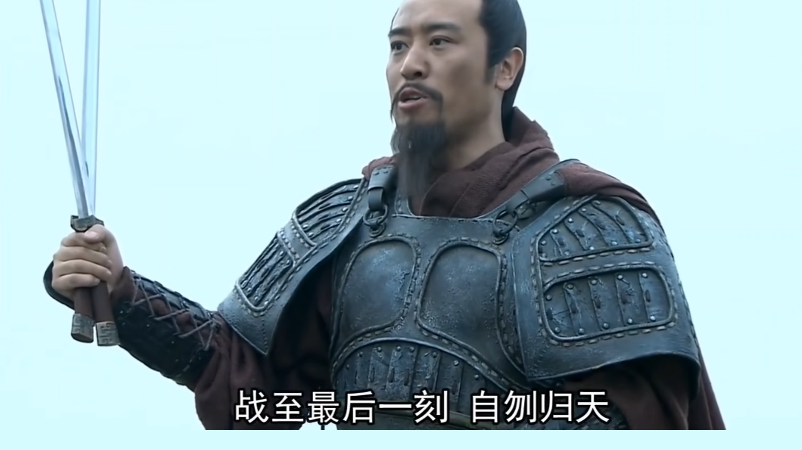

# 新三国梗（折棒系）

> 风从龙，云从虎，龙虎英雄傲苍穹。

给 AstrBot 用的《新三国》梗库插件。只认 2010 年电视剧《新三国》（高希希执导）和 B 站 UP 主「吃蛋挞的折棒」《吐槽新三国》系列衍生的梗。

你甩一句「历史发生了巨变」，她知道这是原剧旁白被网友传讹的版本；你问「窃听机制哪来的」，她分得清这是折棒编的、不是曹操说的。

143 条，梗分三层，谁家的归谁家，不乱认亲戚。不用打斜杠，说人话就行。

原本只是给自家肥鱼用的，能聊梗也能答出处。至少我自己测下来没什么问题，你们用着有毛病就来说。

## 三层出处

| 层级 | 条数 | 出处写法 | 说明 |
|---|---|---|---|
| 原剧梗 | 96 | 原剧台词/场景 | 直接来自剧中台词、名场面，尽量带角色和集数 |
| 折棒体系梗 | 20 | 折棒吐槽系列总结的机制 | 折棒在吐槽里总结的「机制/定律」，不是原剧台词 |
| 评论区梗 | 27 | 折棒系列评论区梗 | 评论区发展出来的固定反应，二创产物 |

## 特性

- **自然语言就能查**：说「窃听机制是什么梗」直接出卡片，不用打 `/`
- **顺口提到会接**：说「我觉得窃听机制太离谱了」不弹卡片，当聊天自然接一句
- **出处分层**：原剧的就说原剧，折棒总结的就说折棒总结的，评论区的就说评论区的
- **群聊防刷屏**：只有被 @、被回复、或明确说「查梗」时才在群里出卡片
- **多轮追问**：记住上一轮讲的梗，说「详细」「还有吗」接着讲
- **零依赖**：不需要 API key，不需要联网，纯本地模糊匹配

## 安装

AstrBot 插件市场搜「新三国梗」，或者手动放进 `data/plugins/astrbot_plugin_dafeiyu_xsg/` 后重载插件。

无额外 Python 依赖。

## 用法

### 自然语言（推荐）

```
窃听机制是什么梗
曹操盖饭是什么意思
说下天意爷的出处
帮我查查曹氏兵法
历史发生了巨变详细讲讲
```

命中且带查询词时直接回卡片；只是提一嘴梗名就交给主模型自然接话。

### 指令

```
/新三 <词>          查一条
/新三识别 <句子>     看这句话里有几个梗
/新三列表           按三层分类列出
/新三随机           随便来一个
/新三国梗           帮助
```

### 多轮

先问「窃听机制」，再发「详细」，会继续展开上一条。

## 配置

| 项 | 默认 | 说明 |
|---|---|---|
| `auto_recognize` | 开 | 自动识别聊天里的梗并接入上下文 |
| `natural_lookup` | 开 | 自然语言问梗时直接回卡片 |
| `group_need_trigger` | 开 | 群聊只在被叫到时才回，防刷屏 |

## 覆盖的梗（部分）

**原剧**：曹操盖饭、不可能绝对不可能、接着奏乐接着舞、医死的人越多医术越高明、好方略不过我想稍作修改、我跟你开玩笑哪、徐州原本就是我的、自刎归天、我二弟天下无敌、仁之剑义之剑、放肆你在教训我吗、零陵上将邢道荣、我的大斧早就饥渴难耐了、八万个馒头、你走了我们吃什么、生死不明那就是死了…

**折棒体系**：天意、窃听机制、曹氏兵法（十六字循环）、哀兵必胜、灵魂锁链、新三国道、时间流速、传送门、天意侵蚀、剧本杀、虚空炼兵、平行宇宙、天子经济学、汉末科技、战力膨胀、复活机制…

**评论区**：历史发生了剧变、都做对的可以称帝了、一想到还有200集、又要开始了吗这绝望的轮回、折棒的SAN值开始动摇、聋可是帝王之征、刘备拥有顶尖的心灵控制力、医术+3、当浮一大白…

## 关于准确性

- 台词和出处尽量核对到具体场景，能查到集数的会标出来
- 有争议的条目会标「考证有分歧」，比如曹氏兵法十六字原文的归属
- 查不到的宁可不说，不编台词、集数和出处

## 数据来源

梗的整理参考了以下公开资料，在此致谢：

- 中文维基语录《三国（电视剧）》条目的台词与场景说明
- Fandom 中文「新三国 Wiki」的台词、模因、新三学分类
- B 站 UP 主「吃蛋挞的折棒」《吐槽新三国》系列的集数标题与内容
- B 站专栏、知乎、萌娘百科等社区资料

本插件与上述平台及 UP 主无隶属关系，仅作梗文化整理与检索用途。所有梗的著作权归原作者与版权方所有。

## 许可

代码 MIT。梗的整理与描述文字基于公开资料归纳，引用请注明来源。
